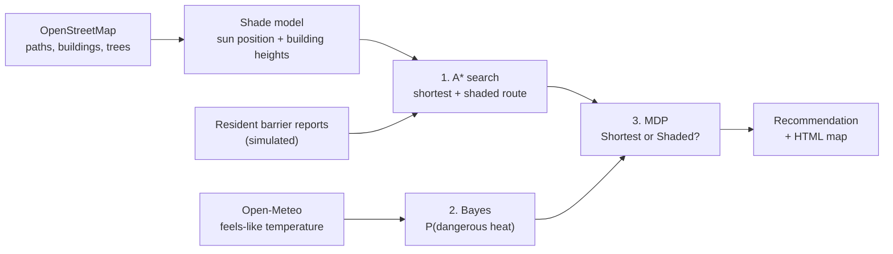

# SAYA: accessible, shade-aware walking routes

**A route planner for wheelchair users and elderly pedestrians in Astana's hot summers. It finds a path they can actually get through, works out how much of it is in the sun, and decides whether the shadier detour is worth it today.**

*Сая* is Kazakh for shade (as in *саябақ*, park). The project is an AI Fundamentals final project. It uses three course algorithms, and each one feeds the next:

| # | Algorithm | Subproblem | Input → Output |
|---|---|---|---|
| 1 | **A\* search** | Find two routes the profile can pass: the shortest one and a shaded one | Real OSM walk network with shade on every edge → two paths with length, sun share and minutes |
| 2 | **Bayesian inference** | Is it dangerously hot right now? | Prior for the month + one noisy reading (Open-Meteo "feels like") → P(dangerous heat) |
| 3 | **MDP** (one Bellman update) | Take the shortest or the shaded route? | Both routes + P(dangerous heat) + the walker's heat vulnerability → recommended action |

<p align="center"></p>

The map covers a 1.7 km circle of Astana's EXPO district: Astana IT University, the Nur Alem sphere, Mega Silk Way, Nazarbayev University and the Botanical Garden.

## Interactive 3D map

```bash
python server.py        # then open http://127.0.0.1:8765
```

- **3D buildings drawn from the shadow model.** Each OSM building and building part is built in three.js with its real height, the height where it starts (parts on columns), and its roof: flat, dome or pyramid. The Nur Alem sphere is a real sphere. Walls get windows for every 3.2 m floor, and the light comes from the sun's actual position. Hover over a building to see its height and where that number comes from.
- **Time of day.** Drag the day timeline (05:00 to 22:00) or press ▶ to play the whole day. The curve shows the sun's height, and the compass shows where the sun is and where the shadows point. The computed shade on the ground rotates and stretches, and the route is recomputed. After sunset the windows light up.
- **Your own trip.** Search a place by name, tap a quick-pick chip, or click the map, then drag either marker. Routing works inside the dashed circle.
- **Who walks.** Wheelchair user, elderly pedestrian, or pedestrian without mobility needs. The barriers, the speeds and the heat vulnerability change with the choice.
- **The decision first, then the reasons.** A card says which route to take and why in one sentence. The two route cards compare minutes, minutes in the sun and heat-stress risk. Below, "How SAYA decided" opens the A\* table (expanded nodes vs Dijkstra), the Bayes calculation and the MDP Q-table. These are the same numbers the CLI prints, because both call `planner.plan_trip()`.
- **Works on a phone.** The planner becomes a bottom sheet, with the decision in one line at the top.

<p align="center"> </p>

The browser only draws. The shadows, A\*, Bayes and the MDP all run in Python (FastAPI). The map uses MapLibre GL with free OpenFreeMap tiles and three.js for the buildings, so no API key is needed.

## Algorithms notebook

[](https://colab.research.google.com/github/Akanov-Kanta/saya/blob/main/SAYA_algorithms.ipynb)

[`SAYA_algorithms.ipynb`](SAYA_algorithms.ipynb) writes out A\*, the Bayes update and the MDP cell by cell, with the formulas. It runs A\* by hand on a four-node toy map (with the expansion order), checks the admissibility of the heuristic on every edge of the real map, prints the Bayes and Bellman calculations, and plots where the MDP decision flips. The last cell checks that the notebook gives exactly the same numbers as the project code. In Colab, *Runtime → Run all* downloads the repo and takes about a minute.

## How it works



**Shade.** `sun.py` computes the sun's altitude and azimuth with NOAA's solar position formulas. `shade.py` turns every building piece into vertical prisms. A flat-roofed block is one prism from its base (the ground, or `min_height` for a part on columns) to its height. A dome, a pyramid roof and the sphere are cut into horizontal slices. A point at height z casts its shadow `z / tan(altitude)` away from the sun, so a prism from z0 to z1 casts its footprint moved by z0, swept along to z1. That is exact for any footprint, including courtyards, and all walls are computed at once with shapely's vectorised functions (about 0.3 s for the whole area). Trees add a 3 m crown of shade, and woods shade their whole area. For every path segment the program measures what share of it lies in the sun (`sun_fraction`, 0 to 1).

**1. A\* search** (`search.py`). Each edge costs

```
cost = length × access penalty × (1 + w × sun_fraction) + crossing penalty
```

The access penalty depends on the mobility profile. Steps and a broken ramp are impassable for a wheelchair. Busy roads without a sidewalk, paving stones and crossings without a traffic light all cost extra. `w = 0` gives the shortest accessible route. `w = 3` gives the shaded one, where one metre in the sun counts as four. "Shortest" means the cheapest route once the accessibility penalties are counted, so at some hours the shaded route can be a few metres shorter. The heuristic is the straight-line distance to the goal. It never overestimates because no edge costs less than its own length, and every length is measured in the same UTM projection as the heuristic (a path is never shorter than the straight line between its ends). So A\* stays optimal. The program also runs Dijkstra (A\* with h = 0) on the same graph, only to show how many fewer nodes A\* expands (878 vs 1988).

**2. Bayesian inference** (`bayes.py`). The hidden state is Dangerous or Safe heat. The sensor is the forecast "feels like" temperature, put in a bucket: cool (< 24 °C), warm (24 to 30 °C) or hot (≥ 30 °C). The forecast is noisy, so each bucket has a likelihood under each state:

```
P(Dangerous | hot) = P(hot | Dangerous) · P(Dangerous) / P(hot)
                   = 0.70 · 0.30 / (0.70 · 0.30 + 0.10 · 0.70) = 0.75
```

**3. MDP** (`mdp.py`). The states are Comfortable and HeatStressed. The actions are the two A\* routes, Shortest and Shaded. Each minute in direct sun carries a small chance of becoming heat-stressed. That chance is 3 % per minute when the heat is dangerous and 0.2 % when it is safe, multiplied by the profile's vulnerability. It is averaged over the Bayes belief. The reward is minus the walking minutes, and ending heat-stressed is worth −60. One Bellman update:

```
Q(s, a) = R(s, a) + γ · Σ P(s' | s, a) · V0(s')        γ = 0.9
```

The recommended action is `argmax_a Q(Comfortable, a)`.

## Sample run

```
$ python main.py          # 15 July 2026, 16:00, wheelchair user, AITU -> Mega Silk Way

0. Map data, sun position and shade
OpenStreetMap: 5125 walk nodes, 15020 edges, 1034 buildings, 125 trees / tree rows
Sun: altitude 38.5 deg, azimuth 256 deg (W) -> a 10 m building casts a 12.6 m shadow towards E
Shade covers 12% of all path length at this time
Barrier report #1: Broken kerb ramp at the crossing to Mega Silk Way [broken_ramp] -> 8 edges, impassable for this profile
Barrier report #2: Steps without a ramp on the path by EXPO C1 [steps] -> 6 edges, impassable for this profile

1. A* search: two accessible routes
route       w   length  in sun  minutes  sun min  A* expanded  Dijkstra
Shortest    0   1560 m    100%     28.9     28.9          878      1988
Shaded      3   1630 m     81%     30.2     24.5         1469      1923
Output: the shaded route is +70 m and +1.3 min, with 236 m less walking in the sun.

2. Bayesian inference: is it dangerously hot?
Input: prior P(Dangerous) for month 7 = 0.30
       sensor = Open-Meteo archive: air 32.7 degC, feels like 31.0 degC -> reading 'hot'
P(hot) = 0.30 x 0.70 + 0.70 x 0.10 = 0.280
P(Dangerous | hot) = 0.210 / 0.280 = 0.750

3. MDP: Shortest or Shaded?
s, a                         P(->Comf.) P(->Stress)       R   Q(s,a)
Comfortable, Shortest             0.428       0.572   -28.9   -59.80
Comfortable, Shaded               0.475       0.525   -30.2   -58.54
HeatStressed, Shortest            0.000       1.000   -28.9   -82.89
HeatStressed, Shaded              0.094       0.906   -30.2   -79.12
Output: start Comfortable -> choose SHADED (Q = -58.54 vs -59.80).

Recommendation
Take the shaded route: 1630 m, about 30 min, 81% in the sun, 53% chance of heat stress.
Map saved to output/route_map.html
```

The same trip gives different answers when the inputs change:

| Run | Weather reading | P(dangerous heat) | Decision |
|---|---|---|---|
| `python main.py` (wheelchair, hot day) | feels like 31.0 °C, hot | 75 % | **Shaded** |
| `python main.py --date 2026-08-20` (cool day) | feels like 17.6 °C, cool | 3 % | **Shortest** |
| `python main.py --profile standard` (hot day) | feels like 31.0 °C, hot | 75 % | **Shaded**, only just (Q −32.3 vs −32.7): a faster, less vulnerable walker gains little from shade |
| `python main.py --profile elderly --time 18:00` | feels like 27.5 °C, warm | 23 % | **Shortest**: shade saves 6 sun-minutes but costs 5 extra minutes |

## Run it

Requires Python 3.10+.

```bash
python3 -m venv .venv && source .venv/bin/activate
pip install -r requirements.txt
python server.py                    # interactive 3D map at http://127.0.0.1:8765
python main.py                      # console version, also saves output/route_map.html
python -m pytest                    # 26 tests
```

Options: `--date YYYY-MM-DD`, `--time HH:MM` (Astana time), `--profile wheelchair|elderly|standard`, `--start` / `--end` (`aitu`, `megasilkway`, `nuralem`, `nu`, `botanical`), `--feels-like 33` to skip the weather API, `--refresh-osm` to download the map again, and `--no-map`.

The OSM data (`data/*.graphml`, `data/*.geojson`) and the weather readings used above (`data/weather_cache.json`) are saved in the repo, so the demo runs offline.

## Tests

`tests/` covers each algorithm on small hand-checked inputs:

- **Sun:** at solar noon on 21 June in Astana the sun is at 62.35° (90° − latitude + 23.44°) and due south.
- **Shade:** a 10 m cube under a 45° sun casts a 10 m shadow away from the sun. A block on columns (5 to 10 m) casts a shadow that starts 5 m away. A sphere casts an ellipse centred under the sun direction, within 15 % of the exact area. A dome is cut into slices that narrow to the top. A line half inside a shadow has a sun fraction of 0.5.
- **A\*:** on a 4-node toy map the sunny street wins with `w = 0` and the shaded street wins with `w = 3`. A broken ramp forces the wheelchair route back into the sun but leaves the pedestrian route alone. On a random 15×15 grid A\* finds exactly Dijkstra's cost while expanding fewer nodes.
- **Bayes:** a hot reading turns a prior of 0.30 into 0.75, and the cool case is checked by hand.
- **MDP:** transition rows sum to 1, Q equals one Bellman backup, and the decision flips from Shaded to Shortest when P(dangerous heat) drops.
- **Web API:** shadows point west in the morning and east in the evening, the night has no sun, a user-picked trip returns the same decision as the CLI, a point outside the map is rejected, the buildings carry their 3D shape (the 100 m sphere, parts on columns), and trees and searchable places are served.

## Assumptions

Every number lives in [`config.py`](config.py) and is a labelled assumption, not a measurement.

- **Building heights** come from the OSM `height` tag (14 pieces) or `building:levels × 3.2 m` (469). The other 551 use a default: 9 m (3 floors), or less for small types such as garages and sheds (`DEFAULT_HEIGHT_BY_TYPE`). The hover tooltip shows the source of every height.
- **Building parts** (`building:part`) follow OSM's Simple 3D Buildings scheme: when an outline has parts, only the parts are drawn and shaded, each with its own `min_height` and roof shape.
- **The Nur Alem sphere** is tagged in OSM as a 100 m part with a round roof. [`data/landmarks.json`](data/landmarks.json) sets its shape to a sphere by hand, and the tooltip says so.
- **Trees** come from OSM: 34 single trees, 66 tree rows and 25 woods inside the area. Parks probably have more trees than are mapped, so real shade is likely higher than computed.
- **Barrier reports** in `data/barriers.json` are **simulated** resident reports for the demo, not verified barriers. OSM has no kerb, step or incline data for this area.
- **Heat model:** the monthly priors, the likelihood table, the per-minute heat-stress rates, the vulnerability multipliers (wheelchair 1.5, elderly 1.8) and the −60 penalty are illustrative values.
- **Shadows** come from buildings and trees only. Terrain, awnings and bus shelters are ignored.

## Limitations and next steps

- Load real tree canopy and building heights, for example from satellite data.
- Let residents submit barrier reports, and run a Bayes update on each report (P(blocked | report)), as in the SONAR app.
- Add a third action, "wait 1 hour for longer shadows", and run full value iteration over the trip legs.
- Use elevation data so that steep slopes count against wheelchair routes.

## Project structure

```
SAYA_algorithms.ipynb  Colab notebook: the three algorithms written out step by step
main.py        CLI: runs the pipeline and prints every step
server.py      web app (FastAPI): shade for any time, routes for any two points, 3D buildings, trees, places
web/           the page: app.js (map, search, timeline), buildings3d.js (three.js buildings and trees),
               panel.js (decision and the three AI steps), sun.js (sun position for the 3D light)
config.py      all inputs and assumptions
osm_data.py    download / load OpenStreetMap data (cached in data/): walk network, building parts, trees, places
sun.py         solar position
shade.py       building shadows, tree shade, sun fraction per edge
planner.py     glue: loads the area once, shade per time (cached), plan_trip() = A* -> Bayes -> MDP
search.py      A* and the accessibility-aware edge cost
bayes.py       heat-risk inference
weather.py     Open-Meteo reading (cached)
mdp.py         2-state / 2-action MDP, one Bellman update
map_view.py    static Folium HTML map for the CLI
tests/         pytest suite
```

## Data

- Map data © [OpenStreetMap](https://www.openstreetmap.org/copyright) contributors, ODbL. Basemap tiles by [OpenFreeMap](https://openfreemap.org).
- Weather data by [Open-Meteo](https://open-meteo.com), CC BY 4.0.
