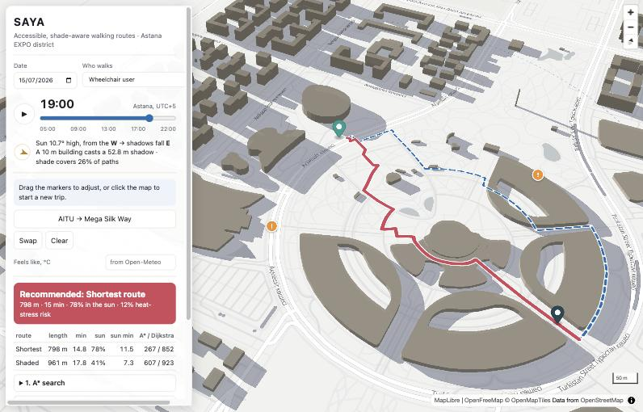
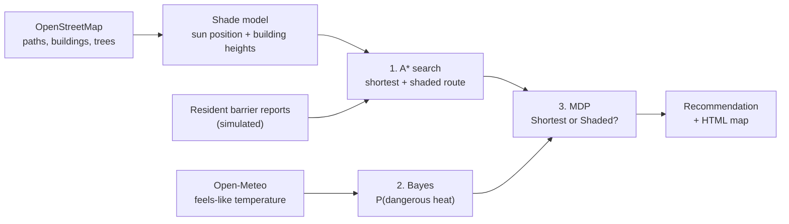

# SAYA: accessible, shade-aware walking routes

**A route planner for wheelchair users and elderly pedestrians in Astana's hot summers. It finds a path they can actually get through, works out how much of it is in the sun, and decides whether the shadier detour is worth it today.**

*Сая* is Kazakh for shade (as in *саябақ*, park). The project is an AI Fundamentals final project. It uses three course algorithms, and each one feeds the next:

| # | Algorithm | Subproblem | Input → Output |
|---|---|---|---|
| 1 | **A\* search** | Find two routes the profile can pass: the shortest one and a shaded one | Real OSM walk network with shade on every edge → two paths with length, sun share and minutes |
| 2 | **Bayesian inference** | Is it dangerously hot right now? | Prior for the month + one noisy reading (Open-Meteo "feels like") → P(dangerous heat) |
| 3 | **MDP** (one Bellman update) | Take the shortest or the shaded route? | Both routes + P(dangerous heat) + the walker's heat vulnerability → recommended action |

<p align="center"></p>

## Interactive 3D map

```bash
python server.py        # then open http://127.0.0.1:8765
```

- **Time of day.** Drag the slider (05:00 to 22:00) or press ▶ to play the whole day. The shadows on the map rotate and stretch with the sun, the 3D buildings are lit from the sun's real direction, and the route is recomputed for that moment.
- **3D buildings.** Every OSM building is extruded to the same height the shadow model uses.
- **Your own trip.** Click the map to set the start, click again to set the destination, and drag either marker to adjust. Routing works inside the dashed circle.
- **Who walks.** Choose wheelchair user, elderly pedestrian or pedestrian without mobility needs. The barriers, the speeds and the heat vulnerability change with the choice.
- **Every step is visible.** The panel shows the A\* table (expanded nodes vs Dijkstra), the Bayes calculation and the MDP Q-table. These are the same numbers the CLI prints, because both call `planner.plan_trip()`.

The browser only draws. The shadows, A\*, Bayes and the MDP all run in Python (FastAPI). The map uses MapLibre GL with free OpenFreeMap tiles, so no API key is needed.

## How it works



**Shade.** `sun.py` computes the sun's altitude and azimuth with NOAA's solar position formulas. `shade.py` then sweeps each building footprint along the shadow vector. Shadow length is `height / tan(altitude)`, and the shadow points away from the sun. Trees add a 3 m crown of shade. For every path segment the program measures what share of it lies in the sun (`sun_fraction`, 0 to 1).

**1. A\* search** (`search.py`). Each edge costs

```
cost = length × access penalty × (1 + w × sun_fraction) + crossing penalty
```

The access penalty depends on the mobility profile. Steps and a broken ramp are impassable for a wheelchair. Busy roads without a sidewalk, paving stones and crossings without a traffic light all cost extra. `w = 0` gives the shortest accessible route. `w = 3` gives the shaded one, where one metre in the sun counts as four. "Shortest" means the cheapest route once the accessibility penalties are counted, so at some hours the shaded route can be a few metres shorter. The heuristic is the straight-line distance to the goal. It never overestimates because no edge costs less than its own length, so A\* stays optimal. The program also runs Dijkstra (A\* with h = 0) on the same graph, only to show how many fewer nodes A\* expands (877 vs 1367).

**2. Bayesian inference** (`bayes.py`). The hidden state is Dangerous or Safe heat. The sensor is the forecast "feels like" temperature, put in a bucket: cool (< 24 °C), warm (24 to 30 °C) or hot (≥ 30 °C). The forecast is noisy, so each bucket has a likelihood under each state:

```
P(Dangerous | hot) = P(hot | Dangerous) · P(Dangerous) / P(hot)
                   = 0.70 · 0.30 / (0.70 · 0.30 + 0.10 · 0.70) = 0.75
```

**3. MDP** (`mdp.py`). The states are Comfortable and HeatStressed. The actions are the two A\* routes, Shortest and Shaded. Each minute in direct sun carries a small chance of becoming heat-stressed. That chance is 3 % per minute when the heat is dangerous and 0.2 % when it is safe, multiplied by the profile's vulnerability. It is averaged over the Bayes belief. The reward is minus the walking minutes, and ending heat-stressed is worth −60. One Bellman update:

```
Q(s, a) = R(s, a) + γ · Σ P(s' | s, a) · V0(s')        γ = 0.9
```

The recommended action is `argmax_a Q(Comfortable, a)`.

## Sample run

```
$ python main.py          # 15 July 2026, 16:00, wheelchair user, AITU -> Mega Silk Way

0. Map data, sun position and shade
OpenStreetMap: 1593 walk nodes, 4840 edges, 204 buildings, 45 trees / tree rows
Sun: altitude 38.5 deg, azimuth 256 deg (W) -> a 10 m building casts a 12.6 m shadow towards E
Shade covers 8% of all path length at this time
Barrier report #1: Broken kerb ramp at the crossing to Mega Silk Way [broken_ramp] -> 8 edges, impassable for this profile
Barrier report #2: Steps without a ramp on the path by EXPO C1 [steps] -> 6 edges, impassable for this profile

1. A* search: two accessible routes
route       w   length  in sun  minutes  sun min  A* expanded  Dijkstra
Shortest    0   1557 m    100%     28.8     28.8          877      1367
Shaded      3   1654 m     81%     30.6     24.7         1269      1380
Output: the shaded route is +98 m and +1.8 min, with 220 m less walking in the sun.

2. Bayesian inference: is it dangerously hot?
Input: prior P(Dangerous) for month 7 = 0.30
       sensor = Open-Meteo archive: air 32.7 degC, feels like 31.0 degC -> reading 'hot'
P(hot) = 0.30 x 0.70 + 0.70 x 0.10 = 0.280
P(Dangerous | hot) = 0.210 / 0.280 = 0.750

3. MDP: Shortest or Shaded?
s, a                         P(->Comf.) P(->Stress)       R   Q(s,a)
Comfortable, Shortest             0.429       0.571   -28.8   -59.67
Comfortable, Shaded               0.473       0.527   -30.6   -59.10
HeatStressed, Shortest            0.001       0.999   -28.8   -82.76
HeatStressed, Shaded              0.097       0.903   -30.6   -79.38
Output: start Comfortable -> choose SHADED (Q = -59.10 vs -59.67).

Recommendation
Take the shaded route: 1654 m, about 31 min, 81% in the sun, 53% chance of heat stress.
Map saved to output/route_map.html
```

The same trip gives different answers when the inputs change:

| Run | Weather reading | P(dangerous heat) | Decision |
|---|---|---|---|
| `python main.py` (wheelchair, hot day) | feels like 31.0 °C, hot | 75 % | **Shaded** |
| `python main.py --date 2026-08-20` (cool day) | feels like 17.6 °C, cool | 3 % | **Shortest** |
| `python main.py --profile standard` (hot day) | feels like 31.0 °C, hot | 75 % | **Shortest**: faster walker, less sun time, lower vulnerability |
| `python main.py --profile elderly --time 18:00` | feels like 27.5 °C, warm | 23 % | **Shortest**: shade saves 6 sun-minutes but costs 5 extra minutes |

## Run it

Requires Python 3.10+.

```bash
python3 -m venv .venv && source .venv/bin/activate
pip install -r requirements.txt
python server.py                    # interactive 3D map at http://127.0.0.1:8765
python main.py                      # console version, also saves output/route_map.html
python -m pytest                    # 21 tests
```

Options: `--date YYYY-MM-DD`, `--time HH:MM` (Astana time), `--profile wheelchair|elderly|standard`, `--start` / `--end` (`aitu`, `megasilkway`), `--feels-like 33` to skip the weather API, `--refresh-osm` to download the map again, and `--no-map`.

The OSM data (`data/*.graphml`, `data/*.geojson`) and the weather readings used above (`data/weather_cache.json`) are saved in the repo, so the demo runs offline.

## Tests

`tests/` covers each algorithm on small hand-checked inputs:

- **Sun:** at solar noon on 21 June in Astana the sun is at 62.35° (90° − latitude + 23.44°) and due south.
- **Shade:** a 10 m cube under a 45° sun casts a 10 m shadow away from the sun. A line half inside a shadow has a sun fraction of 0.5.
- **A\*:** on a 4-node toy map the sunny street wins with `w = 0` and the shaded street wins with `w = 3`. A broken ramp forces the wheelchair route back into the sun but leaves the pedestrian route alone. On a random 15×15 grid A\* finds exactly Dijkstra's cost while expanding fewer nodes.
- **Bayes:** a hot reading turns a prior of 0.30 into 0.75, and the cool case is checked by hand.
- **MDP:** transition rows sum to 1, Q equals one Bellman backup, and the decision flips from Shaded to Shortest when P(dangerous heat) drops.
- **Web API:** shadows point west in the morning and east in the evening, the night has no sun, a user-picked trip returns the same decision as the CLI, and a point outside the map is rejected.

## Assumptions

Every number lives in [`config.py`](config.py) and is a labelled assumption, not a measurement.

- **Building heights** come from the OSM `height` tag (11 buildings), from `building:levels × 3.2 m` (125), or default to 9 m (68).
- **Trees** come from the 45 that OSM maps here. The EXPO park probably has more, so real shade is likely higher than computed.
- **Barrier reports** in `data/barriers.json` are **simulated** resident reports for the demo, not verified barriers. OSM has no kerb, step or incline data for this area.
- **Heat model:** the monthly priors, the likelihood table, the per-minute heat-stress rates, the vulnerability multipliers (wheelchair 1.5, elderly 1.8) and the −60 penalty are illustrative values.
- **Shadows** come from buildings and trees only. Terrain, awnings and bus shelters are ignored.

## Limitations and next steps

- Load real tree canopy and building heights, for example from satellite data.
- Let residents submit barrier reports, and run a Bayes update on each report (P(blocked | report)), as in the SONAR app.
- Add a third action, "wait 1 hour for longer shadows", and run full value iteration over the trip legs.
- Use elevation data so that steep slopes count against wheelchair routes.

## Project structure

```
main.py        CLI: runs the pipeline and prints every step
server.py      web app (FastAPI): shade for any time, routes for any two points
web/           3D map page (MapLibre GL): time slider, click to pick start and end
config.py      all inputs and assumptions
osm_data.py    download / load OpenStreetMap data (cached in data/)
sun.py         solar position
shade.py       building shadows, tree shade, sun fraction per edge
planner.py     glue: loads the area once, shade per time (cached), plan_trip() = A* -> Bayes -> MDP
search.py      A* and the accessibility-aware edge cost
bayes.py       heat-risk inference
weather.py     Open-Meteo reading (cached)
mdp.py         2-state / 2-action MDP, one Bellman update
map_view.py    static Folium HTML map for the CLI
tests/         pytest suite
```

## Data

- Map data © [OpenStreetMap](https://www.openstreetmap.org/copyright) contributors, ODbL. Basemap tiles by [OpenFreeMap](https://openfreemap.org).
- Weather data by [Open-Meteo](https://open-meteo.com), CC BY 4.0.
