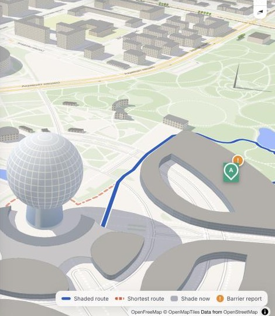
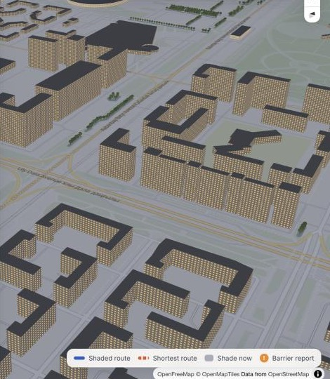
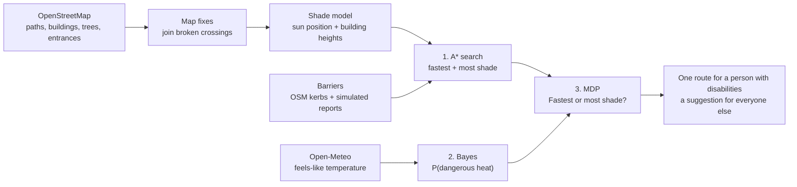

<p align="center">
  <picture>
    <source media="(prefers-color-scheme: dark)" srcset="brand/logo/final/lockups/saya-horizontal-on-dark.svg">
    
  </picture>
</p>

# SAYA: accessible, shade-aware walking routes

**A route planner for Astana's hot summers. A person with disabilities gets one barrier-free route to the door, with SAYA itself deciding whether a shadier detour is worth it today. A person without disabilities picks the fastest or the shadiest route, and SAYA suggests one.**

**Live:** the 3D map at [saya-map.vercel.app](https://saya-map.vercel.app) (the first load can take about 10 seconds while the server starts) · the project page at [saya-pi.vercel.app](https://saya-pi.vercel.app)

*Сая* is Kazakh for shade (as in *саябақ*, park). The project is an AI Fundamentals final project. It uses three course algorithms, and each one feeds the next:

| # | Algorithm | Subproblem | Input → Output |
|---|---|---|---|
| 1 | **A\* search** | Find two routes this person can pass: the fastest and the one with most shade | Real OSM walk network with barriers and shade on every edge → two paths with length, sun share and minutes |
| 2 | **Bayesian inference** | Is it dangerously hot right now? | Prior for the month + one noisy reading (Open-Meteo "feels like") → P(dangerous heat) |
| 3 | **MDP** (one Bellman update) | Fastest or most shade? | Both routes + P(dangerous heat) + the person's heat vulnerability → the route for a person with disabilities, a suggestion for everyone else |

<p align="center"></p>

The map covers a 1.7 km circle of Astana's EXPO district: QAIRU (Qazaq AI Research University, at Alem.ai), the Nur Alem sphere, Mega Silk Way, Nazarbayev University, Astana IT University and the Botanical Garden.

## Interactive 3D map

Online at [saya-map.vercel.app](https://saya-map.vercel.app), or on your own machine:

```bash
python server.py        # then open http://127.0.0.1:8765
```

The landing page in `site/` deploys to Vercel on every push to `main`. The map runs as its own Vercel project; `scripts/deploy_map.sh` deploys it.

- **Two people, two ways of planning.**
  - **Person with disabilities:** SAYA picks the way. A\* keeps only barrier-free paths, and the MDP takes the shadier one only when the heat makes it worth the extra minutes. The map shows one route (teal), plus the direct way in grey dashes with the barriers it has, so you can see what the route goes around.
  - **Person without disabilities:** an *I want: Fastest / Most shade* button. SAYA marks the option it suggests, and the person chooses.
- **Barriers.** Steps, kerbs without a ramp, a broken ramp, a pavement blocked by parked cars and a steep ramp. Two raised kerbs come from OSM; the other reports are simulated for the demo, and the tooltip says which is which.
- **To the door.** A trip to or from a building starts and ends at its entrance: the main one, and if there are several, the one facing the other end of the trip (Mega Silk Way has seven). Nazarbayev University is reached by its main entrance on Qabanbay Batyr Avenue.
- **3D buildings drawn from the shadow model.** Each OSM building and building part is built in three.js with its real height, the height where it starts (parts on columns), and its roof: flat, dome or pyramid. The Nur Alem sphere is a real sphere. Walls get windows for every 3.2 m floor, and the light comes from the sun's actual position. A route behind a building shows through as a faint dashed line. Hover over a building to see its height and where that number comes from.
- **Time of day.** Drag the day timeline (05:00 to 22:00) or press ▶ to play the whole day. The curve shows the sun's height, and the compass shows where the sun is and where the shadows point. The computed shade on the ground rotates and stretches, and the route is recomputed. After sunset the windows light up.
- **Every step is visible.** "How SAYA decided" opens the A\* table (expanded nodes vs Dijkstra, and the direct way), the Bayes calculation and the MDP Q-table. These are the same numbers the CLI prints, because both call `planner.plan_trip()`.
- **Works on a phone.** The planner becomes a bottom sheet, with the route in one line at the top.

<p align="center"> </p>

The browser only draws. The shadows, A\*, Bayes and the MDP all run in Python (FastAPI). The map uses MapLibre GL with free OpenFreeMap tiles and three.js for the buildings, so no API key is needed.

## Algorithms notebook

[](https://colab.research.google.com/github/Akanov-Kanta/saya/blob/main/SAYA_algorithms.ipynb)

[`SAYA_algorithms.ipynb`](SAYA_algorithms.ipynb) writes out A\*, the Bayes update and the MDP cell by cell, with the formulas. It runs A\* by hand on a four-node toy map (with the expansion order), checks the admissibility of the heuristic on every edge of the real map, plots the barrier-free routes from QAIRU to Nazarbayev University next to the direct way, prints the Bayes and Bellman calculations, and shows how the MDP answer depends on P(dangerous heat). The last cell checks that the notebook gives exactly the same numbers as the project code. In Colab, *Runtime → Run all* downloads the repo and takes about a minute.

## How it works



**Map fixes.** OSM draws some crossings in pieces that do not touch. The crossing of Qabanbay Batyr Avenue in front of Nazarbayev University was one of them, and every walk to NU went 2 to 3 km around the campus (QAIRU → NU was 3.8 km without the fixes and is 1.5 km with them). [`data/map_fixes.json`](data/map_fixes.json) joins such gaps by hand, each with a note on why, and adds the NU main entrance, which OSM does not have. Footpaths that end less than 6 m from another walkway are joined automatically, since gaps that small are mapping slips. The web map shows each hand fix with a wrench icon.

**Shade.** `sun.py` computes the sun's altitude and azimuth with NOAA's solar position formulas. `shade.py` turns every building piece into vertical prisms. A flat-roofed block is one prism from its base (the ground, or `min_height` for a part on columns) to its height. A dome, a pyramid roof and the sphere are cut into horizontal slices. A point at height z casts its shadow `z / tan(altitude)` away from the sun, so a prism from z0 to z1 casts its footprint moved by z0, swept along to z1. That is exact for any footprint, including courtyards, and all walls are computed at once with shapely's vectorised functions (about 0.3 s for the whole area). Trees add a 3 m crown of shade, and woods shade their whole area. For every path segment the program measures what share of it lies in the sun (`sun_fraction`, 0 to 1).

**1. A\* search** (`search.py`). Each edge costs

```
cost = length × access penalty × (1 + w × sun_fraction) + crossing penalty
```

The access penalty depends on the person. For a person with disabilities, steps, kerbs without a ramp, a broken ramp, a narrow or steep path are impassable, and roads without a sidewalk, paving stones and crossings without a traffic light cost extra. For a person without disabilities only a construction site blocks the way. `w = 0` gives the fastest route this person can pass (`Shortest` in the code). `w = 3` gives the one with most shade (`Shaded`), where one metre in the sun counts as four. A higher weight did not find shadier ways on the test trips. "Fastest" counts the accessibility penalties, so for a wheelchair user it can be a few metres longer than the shaded route. The heuristic is the straight-line distance to the goal. It never overestimates because no edge costs less than its own length, and every length is measured in the same UTM projection as the heuristic (a path is never shorter than the straight line between its ends). So A\* stays optimal. The program also runs Dijkstra (A\* with h = 0) on the same graph, only to show how many fewer nodes A\* expands (1449 vs 2886 on the sample trip). For a person with disabilities it also runs A\* once more with the profile of a person without disabilities, to show the direct way and the barriers on it.

**2. Bayesian inference** (`bayes.py`). The hidden state is Dangerous or Safe heat. The sensor is the forecast "feels like" temperature, put in a bucket: cool (< 24 °C), warm (24 to 30 °C) or hot (≥ 30 °C). The forecast is noisy, so each bucket has a likelihood under each state:

```
P(Dangerous | hot) = P(hot | Dangerous) · P(Dangerous) / P(hot)
                   = 0.70 · 0.30 / (0.70 · 0.30 + 0.10 · 0.70) = 0.75
```

**3. MDP** (`mdp.py`). The states are Comfortable and HeatStressed. The actions are the two A\* routes. Each minute in direct sun carries a small chance of becoming heat-stressed. That chance is 3 % per minute when the heat is dangerous and 0.2 % when it is safe, multiplied by the person's vulnerability (1.5 with disabilities). It is averaged over the Bayes belief. The reward is minus the walking minutes, and ending heat-stressed is worth −60. One Bellman update:

```
Q(s, a) = R(s, a) + γ · Σ P(s' | s, a) · V0(s')        γ = 0.9
```

The answer is `argmax_a Q(Comfortable, a)`. For a person with disabilities it is the route they get. For a person without disabilities it is shown as "SAYA suggests".

## Sample run

```
$ python main.py          # 15 July 2026, 16:00, person with disabilities, QAIRU -> Nazarbayev University

0. Map data, sun position and shade
OpenStreetMap: 5125 walk nodes, 15084 edges, 1034 buildings, 125 trees / tree rows
Sun: altitude 38.5 deg, azimuth 256 deg (W) -> a 10 m building casts a 12.6 m shadow towards E
Shade covers 12% of all path length at this time
Map fixes: 2 links from data/map_fixes.json, 30 footpath gaps under 6 m joined
End snapped to the building entrance: Nazarbayev University, main entrance
Barrier report #3: Pavement blocked by parked cars on Nurlan Balgymbayev Street [narrow] -> 2 edges, impassable for this profile
...

1. A* search: two routes this person can pass
route       w   length  in sun  minutes  sun min  A* expanded  Dijkstra
Shortest    0   1741 m     91%     32.2     29.3         1449      2886
Shaded      3   1765 m     88%     32.7     28.7         2391      2943
Output: the shaded route is +25 m and +0.5 min, with 32 m less walking in the sun.
Direct way of a person without disabilities: 1455 m, passes: Pavement blocked by parked cars on Nurlan Balgymbayev Street

2. Bayesian inference: is it dangerously hot?
Input: prior P(Dangerous) for month 7 = 0.30
       sensor = Open-Meteo archive: air 32.7 degC, feels like 31.0 degC -> reading 'hot'
P(hot) = 0.30 x 0.70 + 0.70 x 0.10 = 0.280
P(Dangerous | hot) = 0.210 / 0.280 = 0.750

3. MDP: Shortest or Shaded?
s, a                         P(->Comf.) P(->Stress)       R   Q(s,a)
Comfortable, Shortest             0.423       0.577   -32.2   -63.37
Comfortable, Shaded               0.429       0.571   -32.7   -63.52
HeatStressed, Shortest            0.045       0.955   -32.2   -83.79
HeatStressed, Shaded              0.061       0.939   -32.7   -83.42
Output: start Comfortable -> choose SHORTEST (Q = -63.37 vs -63.52).

Recommendation
SAYA picks the fastest route: 1741 m, about 32 min, 91% in the sun, 58% chance of heat stress.
Map saved to output/route_map.html
```

The answer changes with the trip, the weather and the person:

| Run | Weather reading | P(dangerous heat) | Answer |
|---|---|---|---|
| `python main.py` (with disabilities, to NU) | feels like 31.0 °C, hot | 75 % | **Fastest** barrier-free route: the shadier way saves only 0.6 sun-minutes |
| `python main.py --end botanical` | feels like 31.0 °C, hot | 75 % | **Most shade**: a long walk, 4 sun-minutes saved for 0.7 extra minutes |
| `python main.py --end botanical --date 2026-08-20` (cool day) | feels like 17.6 °C, cool | 3 % | **Fastest**: shade is not worth 3 extra minutes when it is cool |
| `python main.py --start nu --end botanical` | feels like 31.0 °C, hot | 75 % | **Most shade**, going around 3 barriers that are on the direct way |
| `python main.py --profile standard --time 18:00` | feels like 27.5 °C, warm | 23 % | SAYA **suggests Fastest**; in the app this person chooses |

## Run it

Requires Python 3.10+.

```bash
python3 -m venv .venv && source .venv/bin/activate
pip install -r requirements.txt
python server.py                    # interactive 3D map at http://127.0.0.1:8765
python main.py                      # console version, also saves output/route_map.html
python -m pytest                    # 30 tests
```

Options: `--date YYYY-MM-DD`, `--time HH:MM` (Astana time), `--profile disabled|standard`, `--start` / `--end` (`qairu`, `megasilkway`, `nu`, `aitu`, `nuralem`, `botanical`), `--feels-like 33` to skip the weather API, `--refresh-osm` to download the map again, and `--no-map`.

The OSM data (`data/*.graphml`, `data/*.geojson`) and the weather readings used above (`data/weather_cache.json`) are saved in the repo, so the demo runs offline.

## Tests

`tests/` covers each algorithm on small hand-checked inputs, and the real map on a few trips:

- **Sun:** at solar noon on 21 June in Astana the sun is at 62.35° (90° − latitude + 23.44°) and due south.
- **Shade:** a 10 m cube under a 45° sun casts a 10 m shadow away from the sun. A block on columns (5 to 10 m) casts a shadow that starts 5 m away. A sphere casts an ellipse centred under the sun direction, within 15 % of the exact area. A dome is cut into slices that narrow to the top. A line half inside a shadow has a sun fraction of 0.5.
- **A\*:** on a 4-node toy map the sunny street wins with `w = 0` and the shaded street wins with `w = 3`. A broken ramp forces the route of a person with disabilities back into the sun but leaves the other route alone. On a random 15×15 grid A\* finds exactly Dijkstra's cost while expanding fewer nodes.
- **Bayes:** a hot reading turns a prior of 0.30 into 0.75, and the cool case is checked by hand.
- **MDP:** transition rows sum to 1, Q equals one Bellman backup, and the decision flips from Shaded to Shortest when P(dangerous heat) drops.
- **Web API:** shadows point west in the morning and east in the evening, the night has no sun, a user-picked trip returns the same decision as the CLI, a point outside the map is rejected, and the buildings carry their 3D shape.
- **Real trips:** Nazarbayev University is reached by its main entrance in under 1.6 km from QAIRU; Mega Silk Way uses the entrance facing the start; a person with disabilities goes around the broken ramp that is on the direct way; a person without disabilities gets two options that differ at 18:00.

## Assumptions

Every number lives in [`config.py`](config.py) and is a labelled assumption, not a measurement.

- **Two profiles.** A person with disabilities walks or rolls at 0.9 m/s with heat vulnerability 1.5 and cannot pass steps, kerbs without a ramp, broken ramps, narrow or steep paths. A person without disabilities walks at 1.3 m/s with vulnerability 1.0.
- **Barriers** in [`data/barriers.json`](data/barriers.json): two raised kerbs are mapped in OSM (`barrier=kerb`, `kerb=raised`). The other five are **simulated** resident reports, placed on the ways people without disabilities take between the main places so that the two profiles get different routes. They are not verified barriers.
- **Map fixes and entrances** in [`data/map_fixes.json`](data/map_fixes.json) are set by hand from the OSM geometry. The NU crossing is assumed to have a traffic light. The NU main entrance is placed on the domed atrium that faces the avenue. Mega Silk Way's seven entrances come from OSM.
- **Building heights** come from the OSM `height` tag (14 pieces) or `building:levels × 3.2 m` (469). The other 551 use a default: 9 m (3 floors), or less for small types such as garages and sheds (`DEFAULT_HEIGHT_BY_TYPE`). The hover tooltip shows the source of every height.
- **Building parts** (`building:part`) follow OSM's Simple 3D Buildings scheme: when an outline has parts, only the parts are drawn and shaded, each with its own `min_height` and roof shape.
- **The Nur Alem sphere** is tagged in OSM as a 100 m part with a round roof. [`data/landmarks.json`](data/landmarks.json) sets its shape to a sphere by hand, and the tooltip says so.
- **Trees** come from OSM: 34 single trees, 66 tree rows and 25 woods inside the area. Parks probably have more trees than are mapped, so real shade is likely higher than computed.
- **Heat model:** the monthly priors, the likelihood table, the per-minute heat-stress rates, the vulnerability multipliers and the −60 penalty are illustrative values. The weather is read at one point (EXPO) for the whole area.
- **Shadows** come from buildings and trees only. Terrain, awnings and bus shelters are ignored.

## Limitations and next steps

- Use OSM's `wheelchair=*`, `kerb=*` and `incline=*` tags on every path once they are mapped here, instead of simulated reports.
- Let residents submit barrier reports, and run a Bayes update on each report (P(blocked | report)), as in the SONAR app.
- Load real tree canopy and building heights, for example from satellite data.
- Add a third action, "wait 1 hour for longer shadows", and run full value iteration over the trip legs.

## Project structure

```
SAYA_algorithms.ipynb  Colab notebook: the three algorithms written out step by step
main.py        CLI: runs the pipeline and prints every step
server.py      web app (FastAPI): shade for any time, routes for any two points, 3D buildings, trees, places
web/           the page: app.js (map, search, timeline, route choice), buildings3d.js (three.js buildings and trees),
               panel.js (the route and the three AI steps), sun.js (sun position for the 3D light)
config.py      all inputs and assumptions: profiles, barrier rules, places
osm_data.py    download / load OpenStreetMap data (cached in data/): walk network, building parts, trees, entrances, places
data/          OSM extracts, barriers.json, map_fixes.json, landmarks.json, weather_cache.json
sun.py         solar position
shade.py       building shadows, tree shade, sun fraction per edge
planner.py     glue: repairs the map, finds entrances, shade per time (cached), plan_trip() = A* -> Bayes -> MDP
search.py      A* and the accessibility-aware edge cost
bayes.py       heat-risk inference
weather.py     Open-Meteo reading (cached)
mdp.py         2-state / 2-action MDP, one Bellman update
map_view.py    static Folium HTML map for the CLI
tests/         pytest suite
site/          the landing page (page.html + Hairline figures, built into index.html by build.mjs)
vercel.json    serves site/ on Vercel for every push to main
scripts/       deploy_map.sh: deploys the 3D map to its own Vercel project
```

## Data

- Map data © [OpenStreetMap](https://www.openstreetmap.org/copyright) contributors, ODbL. Basemap tiles by [OpenFreeMap](https://openfreemap.org).
- Weather data by [Open-Meteo](https://open-meteo.com), CC BY 4.0.
