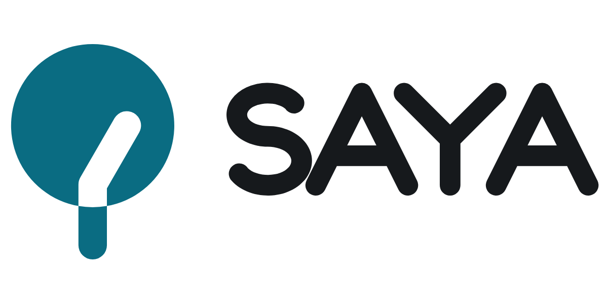

# SAYA logo guidelines

## 1. The logo
- **Idea.** A route walks into the shade of a tree's crown and turns light there. *Сая* is Kazakh for shade, as in *саябақ* (park). The route is a hole cut out of the shade, so wherever the logo goes, the route shows the ground underneath.
- **Versions:** horizontal (the primary version), stacked, symbol only, and wordmark only.
- **Wordmark:** drawn by hand, not set in a font. It is a monoline with round ends and no sharp outer corners: barrier-free letters. Never retype it in a font.

| Use | File |
|---|---|
| Headers, README, slides | `lockups/saya-horizontal.svg` (dark backgrounds: `-on-dark`) |
| Square or tall spaces: posters, signage, title slides | `lockups/saya-stacked.svg` (dark backgrounds: `-on-dark`) |
| Where the symbol is already present | `lockups/saya-wordmark.svg` |
| Icons and avatars, 48 px and larger | `symbol/saya-symbol.svg` |
| 16–32 px, favicons | `symbol/saya-symbol-small.svg`: wider route, bigger crown |
| White on dark backgrounds | `symbol/saya-symbol-reversed.svg`: slightly wider route, slightly smaller crown |
| One colour (black, white, teal) | `export/…-black / -white / -mono-0a6c82.svg` |
| Website | `web/`: favicon.svg (switches teal for dark mode), favicon.ico, PNG icons, `site.webmanifest`, `head-snippet.html` |

## 2. Clear space
**x** = the width of the trunk. Keep at least **2x** clear on every side of any version. The zone scales with the logo.

## 3. Minimum size
| Version | Screen | Print |
|---|---|---|
| Horizontal | 100 px wide | 25 mm wide |
| Stacked | 64 px wide | 16 mm wide |
| Symbol | 48 px (primary cut); 16–47 px uses the small cut | 12 mm (primary); 6–12 mm uses the small cut |

## 4. Colour
The palette uses the landing page's own tokens (`site/page.html`), so the logo and the site match.

| Name | Role | HEX | RGB | CMYK* | Pantone (nearest†) |
|---|---|---|---|---|---|
| **Shade** | the symbol on light backgrounds; app-icon tile | `#0A6C82` | 10 108 130 | 92 17 0 49 | 3145 C |
| **Shade light** | the symbol on dark backgrounds | `#4CC4DC` | 76 196 220 | 65 11 0 14 | 311 C |
| **Ink** | the wordmark on light backgrounds | `#16191C` | 22 25 28 | 21 11 0 89 | Black 6 C |
| **Ink light** | the wordmark on dark backgrounds | `#DFE4E9` | 223 228 233 | 4 2 0 9 | 663 C |
| **Paper** | light background | `#F2F5F5` | 242 245 245 | 1 0 0 4 | — |
| **Night** | dark background | `#0C0F10` | 12 15 16 | 25 6 0 94 | — |
| **Sun** | accent for heat only, never in the logo | `#E8B43A` | 232 180 58 | 0 22 75 9 | 7409 C |

\* Converted directly from RGB. Get a press proof before printing.
† Matched by eye. Check against a physical Pantone guide.

**Contrast (WCAG):**

| Pair | Ratio |
|---|---|
| Shade on white | 6.0 : 1 |
| Shade on Paper | 5.5 : 1 |
| White on Shade (app icon) | 6.0 : 1 |
| Shade light on Night | 9.4 : 1 |
| Ink on Paper | 16.1 : 1 |

Shade on a dark browser tab (`#202124`) reaches only 2.7 : 1. That's why the PNG and `.ico` favicons use the teal tile, and `favicon.svg` switches to Shade light in dark mode.

**Approved pairs:**
- full colour on white or Paper
- the `-on-dark` versions on Night
- white on Shade
- black on white
- on photos, the white or black version on a calm area, or the app-icon tile

## 5. Typography (the landing page's fonts, all under the SIL Open Font License)
- Headlines: **Unbounded** 600
- Body: **IBM Plex Sans** 400 / 600
- Numbers, code and algorithm tables: **IBM Plex Mono**
- Web fallback: `system-ui, sans-serif`

## 6. Don'ts
- Don't stretch, squash or rotate the logo.
- Don't recolour it outside the palette, or put Sun into the logo.
- Don't fill the route hole with a colour. It must show the background.
- Don't use the primary symbol below 48 px. Use the small cut.
- Don't add shadows, outlines, gradients or effects.
- Don't change the size or spacing of the symbol and wordmark in a lockup.
- Don't place the logo on a busy background without the tile.
- Don't retype "SAYA" in a font as a replacement for the wordmark.

## 7. Construction (for whoever edits the masters)
- The masters are generated by `brand/logo/kit.py` (Python standard library only). Change parameters there and re-run it. Don't hand-edit the SVGs.
- **Symbol:** crown r = 86 on a 256 grid. Trunk and route are 30 wide. The route runs up the trunk's axis, turns 30° to the right inside the crown and ends in a round cap. It is all one filled path, with the route as an `evenodd` hole.
- **Wordmark:** cap height 120 and stroke 22. The A legs are on a 1 : 2 slope with the crossbar at 68 %. The Y arms are at 45°. The edges of the S are ellipses offset by half the stroke. Everything is exact arcs and lines, 43 anchor points.
- **Horizontal lockup:** the wordmark's cap height is 0.52 × the symbol's height. The gap is 0.24 × the symbol's height. The wordmark sits halfway between the crown's centre and the lockup's centre.

## 8. Handover notes
- **Tested:** 16, 32 and 48 px pixel tests; one colour; reversed; blur; mirrored and rotated 180°; light and dark backgrounds, a photo and a pattern; a shelf test against travel and transport logos (Google Maps, Maps.me, Airbnb, GetYourGuide). The audit score is 99–100 for every master.
- **Known risk:** in greyscale, a round head on a stem is related to the Google Maps pin, and upside down the symbol reads as a pin. For a route app that hint is partly useful. Three things keep SAYA apart: the teal, the flat-ended trunk instead of a point, and the route cut into the crown. Never draw the trunk with a point.
- **Not done:** a trademark search (it can't be guaranteed here). Check before any public launch, with the Kazakhstan and WIPO databases and a reverse image search.
- **Board placeholders:** the presentation board's mockups show a placeholder URL (`saya.com`) and handle (`@saya`), written by the board tool. They are not real accounts.
- **Not applied yet:** the favicon and logo aren't in `site/` or the app's `web/` yet. `web/head-snippet.html` has the `<head>` tags to paste.
